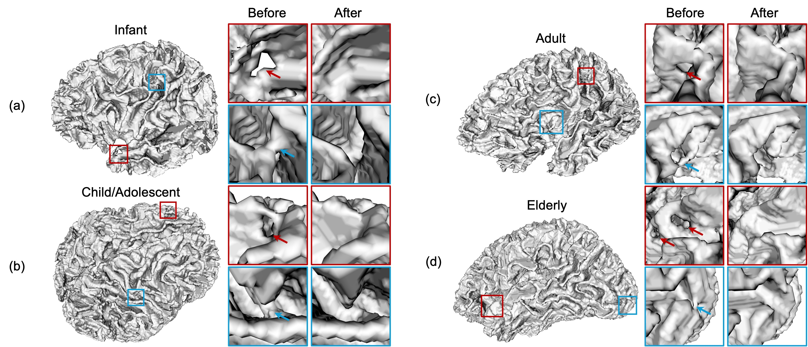
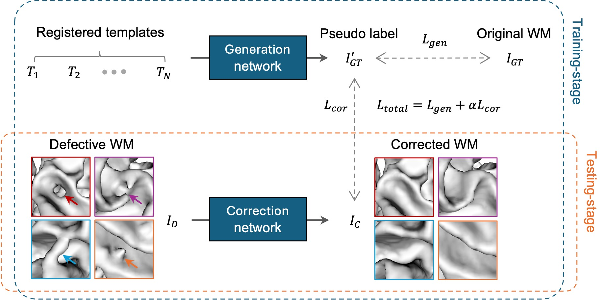
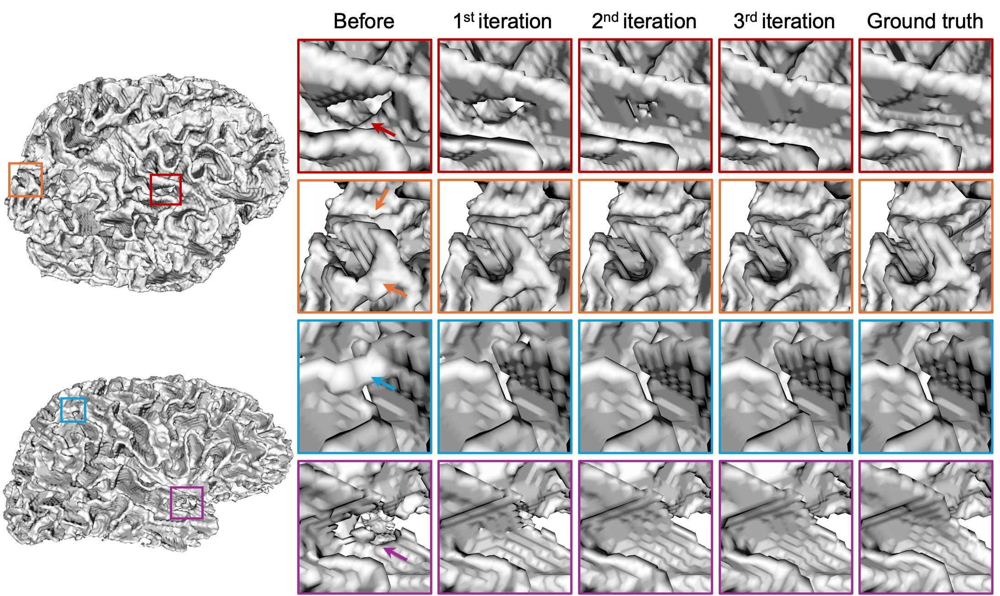

## LifespanFix: Semi-supervised Cortical Correction Across the Human Lifespan

**[DBC Lab, UNC-Chapel Hill](https://liwang.web.unc.edu)**

[Tong Wang](https://scholar.google.com/citations?user=EnnmFqIAAAAJ&hl=zh-CN), [Yue Sun](https://scholar.google.com/citations?user=QMa2E4gAAAAJ&hl=zh-CN), [Li Wang](https://scholar.google.com/citations?user=xjzMf0cAAAAJ&hl=zh-CN)

> **Note:** This repository is under active development. Questions and suggestions are welcome via [GitHub Issues](https://github.com/ittong/LifespanFix/issues).

**LifespanFix** is a lifespan-robust cortical correction model that directly fixes topological and anatomical defects in white matter (WM) segmentations. It was trained on 3,189 subjects spanning the human lifespan, from infancy to older adulthood, across nine public datasets.
<p align="center">
  
</p>

We developed a **semi-supervised framework** in which a generation network produces template-constrained pseudo-labels that serve as structurally plausible targets for training a correction network (LifespanFix). During inference, only the trained LifespanFix model is deployed, enabling efficient end-to-end correction without requiring the generation network or the time-intensive registration used during training.
<p align="center">
  
</p>

## Installation
Install [PyTorch](https://pytorch.org/get-started/locally/) (CUDA support recommended), then:
```
git clone https://github.com/ittong/LifespanFix.git
cd LifespanFix
pip install -r requirements.txt
```

## Getting Started
The input is a binary WM segmentation (0 = background, 1 = WM) in `.nii.gz` format. In our paper, all WM segmentations were processed in 0.8 mm isotropic resolution space.

Download a [model checkpoint](https://drive.google.com/drive/folders/1ENl2m2Es15bvlHNB7hV6UKN5m9aSv28_?usp=share_link) into `model/`, then run:
```
python infer.py --checkpoint model/correction_net_4error_free_wm.pth --input_dir test_example --output_dir results --device cuda:0
```

LifespanFix is applied iteratively, with the probabilistic output from each iteration used to update the WM segmentation for the next iteration, allowing complex defects to be progressively corrected. Three iterations are sufficient to correct most defects, including large and structurally complex cases, whereas moderate and smaller defects typically require only one or two iterations.
<p align="center">
  
</p>

We provide checkpoints trained with different proportions of training subjects without simulated defects, which support different levels of correction.

## Genus-0 Topology for Downstream Applications
Although LifespanFix effectively corrects topological and anatomical defects in WM segmentations, its patch-wise correction does not explicitly guarantee strict genus-0 topology for the entire cortical surface. For downstream applications that do not require genus-0 topology, such as WM volume measurement and other voxel-based analyses, LifespanFix outputs can be used directly. For downstream applications requiring strict genus-0 topology, such as spherical mapping for cortical surface registration and parcellation, genus-0 enforcement can be performed as an independent procedure. It is not an essential component of LifespanFix.

For convenience, we provide a genus-0 enforcement script based on the fast-marching topology correction of Bazin and Pham [1, 2]. Our implementation (`utils/topology.py`) was written with reference to the Python/Numba implementation in CortexODE [3] ([`util/tca.py`](https://github.com/m-qiang/CortexODE/blob/main/util/tca.py), https://github.com/m-qiang/CortexODE). Please also cite [1, 2] if you use it.
```
python genus0.py --input_dir results --output_dir results_genus0
```
Note that enforcing genus-0 topology does not necessarily ensure anatomical accuracy. For example, an incorrect WM connection between neighboring gyri can be eliminated either by removing the connection or by filling the corresponding tunnel. Both operations satisfy the genus-0 constraint but produce different cortical boundaries, and only one may accurately represent the underlying anatomy.

## Training
```
python train.py --data_dir data_dir --save_dir checkpoint --device cuda:0
```
Each subject folder in `data_dir` contains the WM segmentation (`wm.nii.gz`), the WM templates deformably registered to it (`templates/*.nii.gz`), and optionally the detected defect regions (`defect.nii.gz`). Topological and anatomical defects are simulated from the WM segmentations as described in our paper.

## References
[1] P.-L. Bazin and D. L. Pham, "Topology correction using fast marching methods and its application to brain segmentation," in *Proc. MICCAI*, 2005, pp. 484–491. doi: [10.1007/11566489_60](https://doi.org/10.1007/11566489_60)

[2] P.-L. Bazin and D. L. Pham, "Topology correction of segmented medical images using a fast marching algorithm," *Comput. Methods Programs Biomed.*, vol. 88, no. 2, pp. 182–190, 2007. doi: [10.1016/j.cmpb.2007.08.006](https://doi.org/10.1016/j.cmpb.2007.08.006)

[3] Q. Ma, L. Li, E. C. Robinson, B. Kainz, D. Rueckert, and A. Alansary, "CortexODE: Learning cortical surface reconstruction by neural ODEs," *IEEE Trans. Med. Imaging*, vol. 42, no. 2, pp. 430–443, 2023. doi: [10.1109/TMI.2022.3206221](https://doi.org/10.1109/TMI.2022.3206221)

## Citation
If you find LifespanFix useful, please cite our paper. The BibTeX entry will be added once the paper is published.

## License
This project is released under the [Apache License 2.0](LICENSE).
