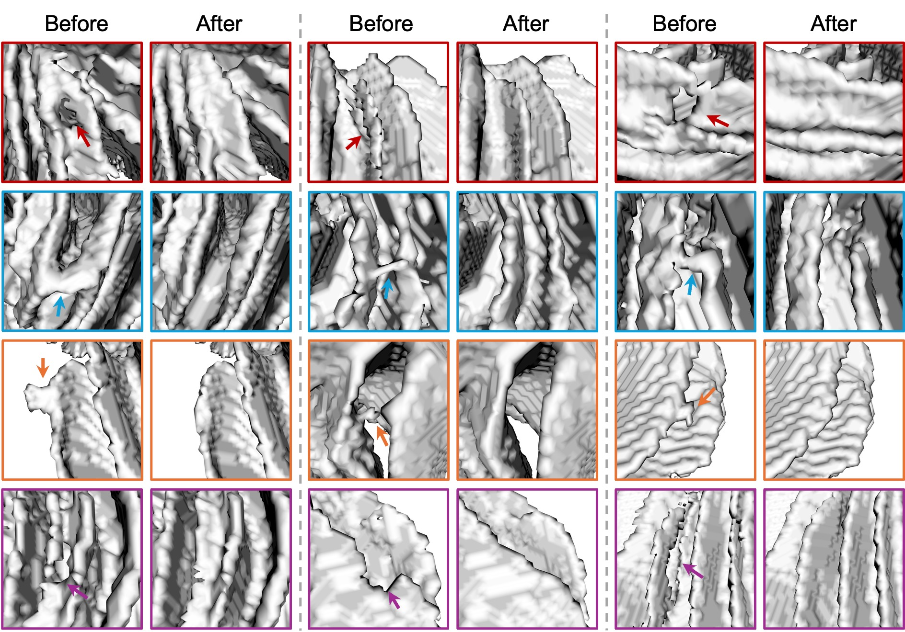

## LifespanFix: Semi-supervised Cortical Correction Across the Human Lifespan

**[DBC Lab, UNC-Chapel Hill](https://liwang.web.unc.edu)**

[Tong Wang](https://scholar.google.com/citations?user=EnnmFqIAAAAJ&hl=zh-CN), [Yue Sun](https://scholar.google.com/citations?user=QMa2E4gAAAAJ&hl=zh-CN), [Li Wang](https://scholar.google.com/citations?user=xjzMf0cAAAAJ&hl=zh-CN)

**LifespanFix** is an end-to-end model for topological and anatomical correction of cortical surfaces that operates on white matter segmentations, and can be readily integrated into existing processing pipelines. The model operates iteratively, progressively correcting complex topological and anatomical defects while preserving anatomically correct regions. It has been trained on a dataset of 3,189 subjects from 9 public cohorts spanning the lifespan, and demonstrates stable performance across diverse developmental stages.
<p align="center">
  
</p>


We developed a **semi-supervised framework** consisting of a generation network and a correction network, where the latter is termed LifespanFix. The generation network produces template-constrained pseudo labels that provide anatomically and topologically plausible supervision. During inference, only LifespanFix is required to iteratively correct input WM segmentations in an end-to-end manner, without any time-consuming registration.
<p align="center">
  
</p>

## Installation

The code requires `python>=3.8` and `pytorch>=1.7`. Please follow the instructions [here](https://pytorch.org/get-started/locally/) to install PyTorch dependencies. Installing PyTorch with CUDA support is strongly recommended.

clone the repository locally with

```
git clone https://github.com/ittong/LifespanFix.git
cd LifespanFix
```

The following optional dependencies are necessary for MRI processing and saving. 

```
pip install nibabel
```

## <a name="GettingStarted"></a>Getting Started
First download a [model checkpoint](https://drive.google.com/drive/folders/1ENl2m2Es15bvlHNB7hV6UKN5m9aSv28_?usp=share_link). Then the model can be used in just one line to obtain the corrected result from an input white matter segmentation:

```
python infer.py --checkpoint <path/to/checkpoint> --input_dir <path/to/input> --output_dir <path/to/output> --device <device/id>
```

We provide a series of checkpoints that support different levels of correction. To preserve more of the original WM segmentation:
```
python infer.py --checkpoint checkpoint/correction_net_10error_free_wm.pth --input_dir test_example --output_dir results --device cuda:0
```

To perform more aggressive correction:
```
python infer.py --checkpoint checkpoint/correction_net_7error_free_wm.pth --input_dir test_example --output_dir results --device cuda:0
```

## Results
In practice, three iterations are sufficient to correct most defects, including large and structurally complex cases, whereas moderate and smaller defects typically require only one or two iterations. We have uploaded the corrected results on our testing set [here]().

<p align="center">
  
</p>

Notably, SurfFix also demonstrates strong zero-shot generalization to cerebellar white matter segmentations (see below), effectively correcting diverse defects and suggesting that it learns transferable defect-correction principles beyond the cerebral cortex. A dedicated cerebellar correction model will be released soon, and the proposed semi-supervised correction framework may also be extended to other segmentation correction tasks, such as coronary artery reconstruction.
<p align="center">
  
</p>
